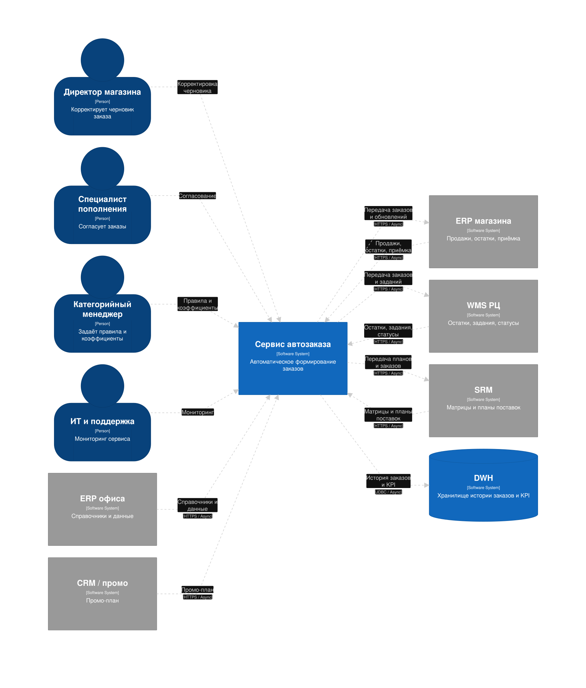
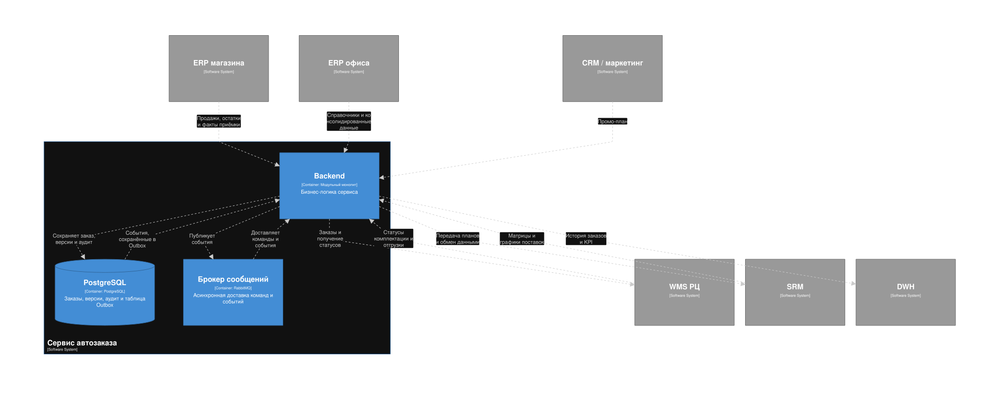
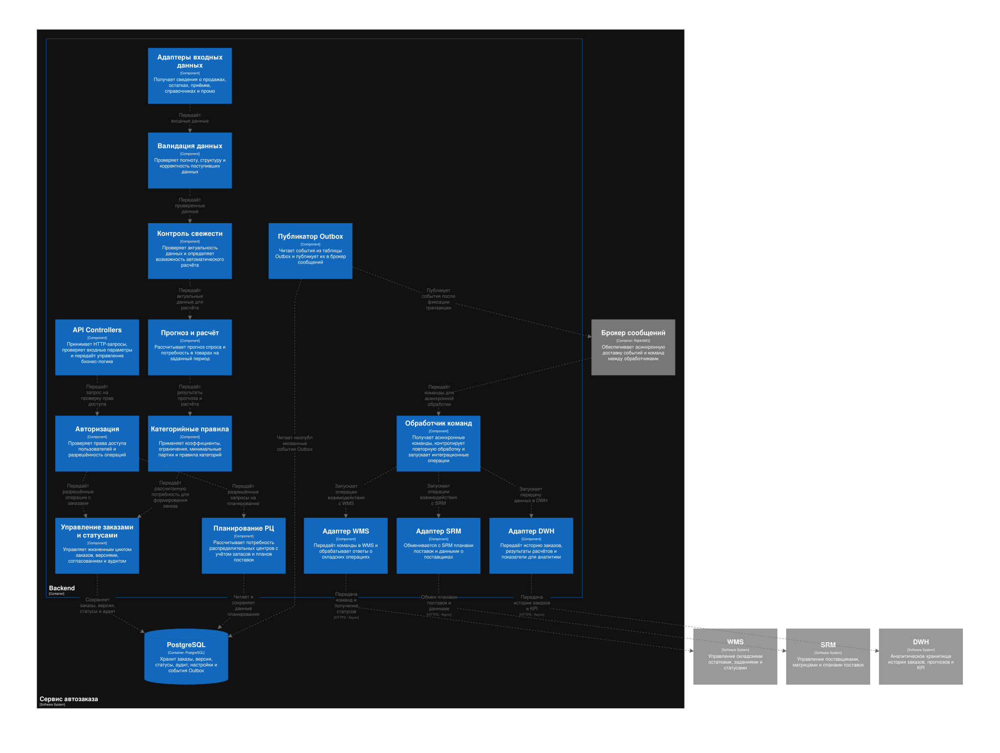
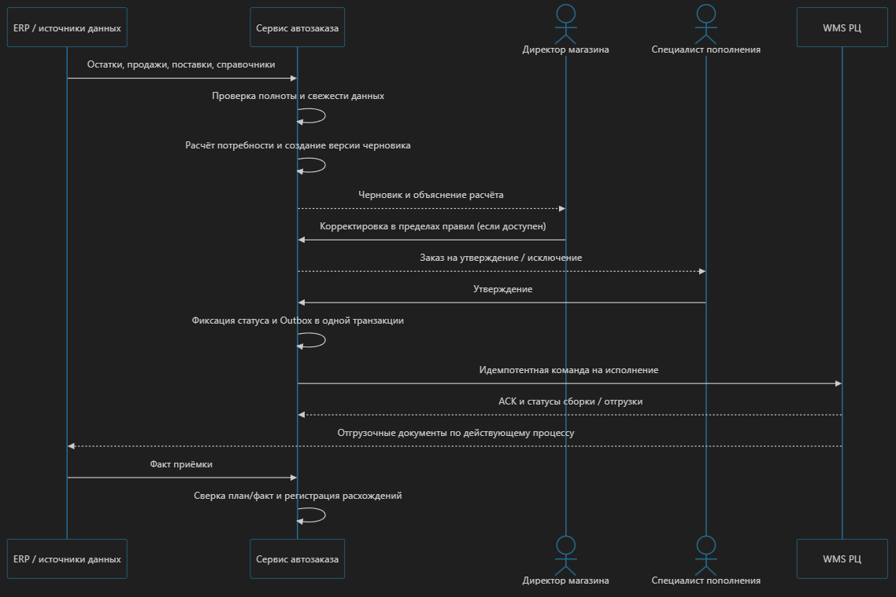

# Архитектурное решение: сервис автозаказа скоропортящихся товаров
 
**Горизонты планирования:** оперативный — 14 дней; долгосрочный — 1–6 месяцев

>**Статус данных:**
>- **[ТЗ]** — требование задания.
>- **[Открытый источник]** — публичные сведения.
>- **[Модельное допущение]** — условное значение для расчётов.
>- **[Проектная цель]** — предварительный ориентир, подлежащий проверке.

Внутренние бизнес-метрики компании неизвестны и не предполагаются как факты.

---

## 1. Архитектурное решение

Предлагается **модульный монолит с асинхронными фоновыми обработчиками**. Сервис рассчитывает потребность магазинов, управляет жизненным циклом заказов, поддерживает согласование и передаёт утверждённые заказы в WMS. Дополнительно формируется потребность в пополнении распределительных центров.

Существующие системы сохраняют свои зоны ответственности:

- **ERP магазина** — продажи, остатки, движения товаров и приёмка.
- **ERP офиса** — номенклатура, цены, сроки годности и консолидированные данные.
- **WMS** — складские остатки, комплектация и отгрузка.
- **SRM** — ассортиментная матрица, графики поставок и взаимодействие с поставщиками.
- **DWH** — историческая аналитика и оценка бизнес-эффекта.

Основные принципы:

1. Расчёт потребности с учётом спроса, пригодных остатков, поставок в пути и сроков годности.
2. Разделение оперативного пополнения РЦ на 14 дней и долгосрочного прогнозирования.
3. Централизованное управление статусами, версиями и историей изменений заказов.
4. Идемпотентная обработка интеграций, Transactional Outbox и контролируемые повторы.
5. Блокировка автоматического утверждения при недостаточной свежести или полноте данных.

### 1.1. Расчётный масштаб

| Параметр | Значение | Статус |
|---|---:|---|
| Магазины | 800 | [Модельное допущение], сценарий масштабирования |
| Распределительные центры | 6 | [Модельное допущение] |
| Целевые SKU на магазин | 1 000 | [Модельное допущение] |
| Доля SKU в одной волне расчёта | 20% | [Модельное допущение] |
| Волн расчёта в сутки | 2 | [Модельное допущение] |
| Горизонт пополнения РЦ | 14 дней | [ТЗ] |
| Консолидация статистики магазинов | 2 раза в сутки | [ТЗ] |
| Автономная работа ERP магазина | До 3 суток | [ТЗ] |

Масштаб 800 магазинов используется как сценарий нагрузки, а не как подтверждённый размер контура внедрения. По открытым данным, сеть «Победа» насчитывала более 770 магазинов в 2026 году; фактический контур и количество РЦ для проекта не подтверждены. [Источник: официальный сайт сети](https://xn--80aaadiigoj9aqmm.xn--p1ai/press_smi/%D0%BA%D0%B0%D0%BA-%D1%81%D0%B5%D1%82%D1%8C-%D0%B4%D0%B8%D1%81%D0%BA%D0%B0%D1%83%D0%BD%D1%82%D0%B5%D1%80%D0%BE%D0%B2-%D0%BF%D0%BE%D0%B1%D0%B5%D0%B4%D0%B0-%D0%BF%D0%B5%D1%80%D0%B5%D0%B2/).

## 2. Архитектура C4

Диаграммы отражают логические границы решения. Конкретные интерфейсы и протоколы уточняются по фактическим возможностям систем.

[Более детально диаграммы можно рассмотреть тут](https://www.figma.com/design/9zhhU1TKZ5FGOGPvt6jp7A/%D0%B0%D1%80%D1%82?node-id=1-1196&t=7TjFwUZdHfEwbnz4-1)

### 2.1. Context

### 2.2. Container

### 2.3. Component

### 2.4. Основной сценарий

1. Сервис получает продажи, остатки, поставки и справочники.
2. Проверяет полноту и свежесть данных, рассчитывает потребность и создаёт черновик.
3. Директор магазина корректирует заказ, если это допускается правилами.
4. Специалист пополнения утверждает заказ.
5. Сервис фиксирует статус и команду в Outbox; фоновый обработчик передаёт заказ в WMS.
6. WMS возвращает статусы комплектации и отгрузки. После приёмки в ERP выполняется сверка план/факт.
7. Прогноз потребности магазинов агрегируется для планирования пополнения РЦ и подготовки заказов поставщикам через SRM.

## 3. Архитектурный стиль и технологии

**Архитектурный стиль:** модульный монолит с фоновыми обработчиками. Он упрощает транзакционность и эксплуатацию по сравнению с преждевременным выделением микросервисов, сохраняя возможность независимого масштабирования API и фоновых процессов.

| Компонент | Предлагаемое решение | Обоснование |
|---|---|---|
| Backend | Java 21 / Spring Boot 3 | Подходит для корпоративного сервиса с интеграциями и транзакционной бизнес-логикой |
| Транзакционная БД | PostgreSQL | Заказы, версии, статусы, аудит и Outbox в едином транзакционном контуре |
| Асинхронный обмен | RabbitMQ + Transactional Outbox | Надёжная доставка команд и повторная обработка |
| API | REST / JSON | Интеграция с системами, поддерживающими API |
| Файловый обмен | По возможностям ERP и WMS | Соответствует ограничениям из ТЗ |
| Мониторинг | OpenTelemetry, Prometheus, Grafana | Метрики, трассировки и контроль ошибок |

Альтернативы: C#/.NET вместо Java при соответствии корпоративному стандарту; Kafka — при необходимости потоковой обработки и большом количестве потребителей; Redis — при подтверждённой потребности в распределённом кешировании. Дополнительные компоненты не вводятся без обоснования.

## 4. Бизнес-логика и интеграции

### 4.1. Расчёт заказа

Базовая модель потребности для пары «магазин — SKU»:

$$
Q = \max(0,\; T - A - I + L)
$$

где:

- \(Q\) — расчётное количество к заказу;
- \(T\) — целевой запас до следующей поставки;
- \(A\) — прогнозируемый доступный остаток, пригодный к реализации;
- \(I\) — подтверждённые поставки в пути, ожидаемые до момента потребности;
- \(L\) — ожидаемые потери, если они ещё не учтены в прогнозе или целевом запасе.

Целевой запас учитывает прогноз спроса, график поставок и страховой запас. Промо- и сезонные коэффициенты применяются при расчёте прогноза. Для скоропортящихся товаров дополнительно учитываются сроки годности, ожидаемая реализация, кратность упаковки, минимальные партии и ограничения РЦ.

Формула является базовой моделью: параметры и пригодный остаток должны рассчитываться с учётом категории товара. Повторный учёт естественной убыли исключается.

### 4.2. Планирование поставок

- **Оперативный горизонт — 14 дней:** дневной прогноз потребности магазинов, консолидация по SKU и РЦ, учёт остатков, поступлений, сроков годности, графиков поставок и ограничений склада.
- **Долгосрочный горизонт — 1–6 месяцев:** агрегированный прогноз по товарным подгруппам и периодам для планирования закупок и поставочных мощностей. Горизонт является проектным предположением.

Результат планирования — проект потребности РЦ и рекомендации по закупкам. Заказы поставщикам оформляются в рамках предусмотренного процесса SRM.

### 4.3. Интеграции

| Система | Данные | Способ обмена по ТЗ |
|---|---|---|
| ERP магазина | Продажи, остатки, движения, приёмка | Файлы / доступный API; консолидация дважды в сутки |
| ERP офиса | Номенклатура, цены, сроки годности | API / файлы; CDC поддерживается |
| WMS | Остатки РЦ, комплектация, отгрузка | Файловый обмен; CDC поддерживается |
| SRM | Матрицы, графики, заказы поставщикам | API / транзакционная шина |
| CRM | Промо-план | Доступный API / регламентная выгрузка |
| DWH | История заказов и KPI | ETL / выгрузки через семантический слой |

CDC, Kafka и Debezium не являются обязательными только на основании поддержки соответствующих механизмов системами. Конкретные контракты и способы обмена определяются при проектировании интеграций.

### 4.4. Обработка ошибок и особых ситуаций

| Ситуация | Поведение |
|---|---|
| Данные устарели или неполны | Блокировка автоподтверждения при критичных нарушениях, передача на разбор |
| Магазин изолирован | Использование последнего допустимого снимка только по согласованным правилам |
| WMS недоступна | Outbox, повторные попытки с задержкой, контроль статуса команды |
| Дефицит товара на РЦ | Распределение по согласованным приоритетам, фиксация недопоставки |
| Повторный файл или запрос | Проверка идентификатора пакета и бизнес-ключа |
| Расхождение при приёмке | Регистрация исключения и сверка план/факт |

Автономность ERP магазина не гарантирует актуальности центральных данных. При восстановлении связи сервис сверяет накопленные движения и статусы, не изменяя закрытые операции задним числом.

## 5. Состояние, надёжность и безопасность

**Хранение состояния.** PostgreSQL хранит заказы, строки, версии расчёта, статусы, ключевые входные данные, применённые правила, аудит ручных изменений и Outbox.

**Жизненный цикл заказа:** черновик → на согласовании → утверждён → передан в WMS → отгружен → принят → закрыт. Отмены и ошибки фиксируются отдельными статусами и причинами.

**Надёжность:**

- Transactional Outbox — атомарная фиксация изменения заказа и команды.
- Идемпотентность — защита от повторной обработки запросов и файлов.
- Повторные попытки с экспоненциальной задержкой и ограничением количества попыток.
- Optimistic Locking — защита от конфликтующих изменений.
- Сверка статусов сервиса, WMS и ERP — контроль исполнения и приёмки.

**Кеширование.** Допустимо кешировать относительно стабильные справочники и настройки. Остатки и статусы не считаются достоверными только по кешу: контролируется возраст данных.

**Безопасность:**

- RBAC с ограничением доступа по роли, магазину и дивизиону.
- Корпоративная аутентификация, TLS и управление секретами.
- Аудит критичных действий, включая утверждение заказов и изменение коэффициентов.
- Контроль целостности файлов и защита от повторной загрузки.
- Резервное копирование и проверка восстановления.

## 6. Нефункциональные требования и нагрузка

Все числовые значения ниже — предварительные проектные цели, а не подтверждённые характеристики инфраструктуры.

### 6.1. Оценка нагрузки

При 800 магазинах, 1 000 целевых SKU и обработке 20% ассортимента за волну:

$$
N_{\text{волна}} = 800 \times 1000 \times 0{,}2 = 160\,000
$$

При двух волнах в сутки:

$$
N_{\text{сутки}} = 160\,000 \times 2 = 320\,000
$$

При условной конверсии проверяемых позиций в строки заказов 30%:

$$
N_{\text{строк}} = 320\,000 \times 0{,}3 = 96\,000
$$

Это сценарная оценка количества обработок и строк заказов, а не фактический прогноз. Конверсия 30% является модельным допущением и требует калибровки на исторических данных.

Для обработки 160 000 позиций за 30 минут необходимая средняя пропускная способность составит:

$$
V = \frac{160\,000}{30 \times 60} \approx 89
$$

То есть около 89 позиций в секунду. Это ориентир для фонового расчётного контура; фактическая производительность зависит от сложности правил, доступа к данным и параллелизма.

### 6.2. Целевые NFR

| Показатель | Проектная цель |
|---|---|
| Открытие черновика | P95 ≤ 300 мс |
| Сохранение корректировки | P95 ≤ 400 мс |
| Расчёт одного магазина | ≤ 60 секунд |
| Расчёт по 800 магазинам | ≤ 30 минут |
| Планирование РЦ на 14 дней | ≤ 15 минут |
| Устойчивая нагрузка API | 30 RPS |
| Пиковая нагрузка API | 60 RPS |
| Доступность сервиса | 99,5% в месяц |
| RPO | ≤ 15 минут |
| RTO | ≤ 4 часов |

Цели подтверждаются нагрузочным тестированием и испытаниями восстановления. RPO/RTO относятся к восстановлению сервиса и данных и не заменяют требования к свежести входных данных.

**Наблюдаемость:** метрики API и фоновых задач, структурированные логи, трассировки, длина очередей, возраст данных, ошибки интеграций и расхождения план/факт.

## 7. Риски и их митигация

| Риск | Меры снижения |
|---|---|
| Устаревшие данные магазина | Контроль свежести, запрет автоподтверждения при критичных нарушениях, резервный регламент |
| Ошибки прогноза и избыточный заказ | Пилот, категорийные правила, контроль списаний и OSA |
| Дубли или потеря команд WMS | Outbox, бизнес-ключи, идемпотентность и сверка статусов |
| Неточные сроки годности и нормы убыли | Контроль качества мастер-данных и аудит списаний |
| Дефицит товара на РЦ | Согласованные приоритеты распределения и фиксация недопоставки |
| Изменения промо-плана | Версионирование, контроль актуальности и пересчёт затронутых SKU |
| Недоверие пользователей | Объяснение расчёта, журнал корректировок и пилот |
| Завышенная оценка эффекта | Базовая линия, контрольная группа и единая методика расчёта KPI |
| Несовместимость интеграций | Проверка контрактов и механизмов обмена до промышленного запуска |

## 8. Экономическое обоснование и метрики успеха

Основная цель продукта — **снижение стоимости списаний от естественной порчи без ухудшения доступности товара на полке и роста избыточных запасов**.

Значения KPI ниже являются предварительными целями для пилота. Они не представляют собой прогноз фактических результатов компании.

| Метрика | Предварительный ориентир | Метод измерения |
|---|---|---|
| Стоимость списаний целевых категорий | Снижение на 8–12% | Сравнение с базовым периодом и контрольной группой |
| Доступность товара на полке (OSA) | Не ниже базового уровня; ориентир ≥ 96% | Доля доступных SKU в согласованных проверках |
| Точность прогноза (WAPE) | Ориентир ≤ 20–25% | Сравнение прогноза с фактическим спросом по категориям |
| Заказы без ручной корректировки | Ориентир ≥ 80% | Доля заказов без изменений при сохранении целевых KPI |
| Время оформления заказа | Снижение относительно базового уровня | Хронометраж до и после внедрения |
| Исполнение в окно поставки | Улучшение относительно базового уровня | Сопоставление сроков заказа, отгрузки и приёмки |
| Ошибки и дубли исполнения | Отсутствие неразобранных критичных случаев | Сверка заказов с WMS и ERP |

Основной KPI — снижение стоимости списаний при сохранении или улучшении OSA. Точность прогноза, доля заказов без корректировок и исполнение поставок используются как дополнительные показатели качества решения.

### Оценка финансового эффекта

Для предварительной оценки используется формула:

$$
E_{\text{год}} = W_{\text{год}} \times r - C_{\text{доп}}
$$

где:

$$
\begin{aligned}
E_{\text{год}} &\text{ — годовой чистый экономический эффект;}\\
W_{\text{год}} &\text{ — годовая стоимость списаний целевых категорий товаров;}\\
r &\text{ — подтверждённая доля снижения списаний;}\\
C_{\text{доп}} &\text{ — дополнительные годовые затраты на эксплуатацию и внедрение.}
\end{aligned}
$$

**Иллюстративный пример [Модельное допущение]:** при годовой стоимости списаний 120 млн ₽ и снижении на 10% валовой эффект составит 12 млн ₽ в год до вычета дополнительных затрат. Значение 120 млн ₽ не относится к фактическим данным компании.

Экономия от сокращения трудозатрат учитывается отдельно: высвобождение рабочего времени само по себе не означает сокращения денежных расходов.

Эффект оценивается на сопоставимых магазинах с учётом сезонности, промо, оборота и графиков поставок. Стоимость списаний рассчитывается по единой учётной методике.

## 9. Источники и допущения

1. [Официальный сайт сети «Победа» — развитие сети](https://xn--80aaadiigoj9aqmm.xn--p1ai/%D0%BE-%D0%BA%D0%BE%D0%BC%D0%BF%D0%B0%D0%BD%D0%B8%D0%B8/) — публичные сведения о масштабе сети.
2. [Официальный сайт сети «Победа» — публикации о развитии сети](https://xn--80aaadiigoj9aqmm.xn--p1ai/%D1%81%D0%BC%D0%B8-%D0%BE-%D0%BD%D0%B0%D1%81/) — дополнительные сведения о количестве магазинов и развитии инфраструктуры.

Открытые источники используются только для ориентировочной оценки масштаба сети. Количество магазинов и РЦ в конкретном контуре, фактическая нагрузка, стоимость списаний и производительность внутренних систем не подтверждены.

---
